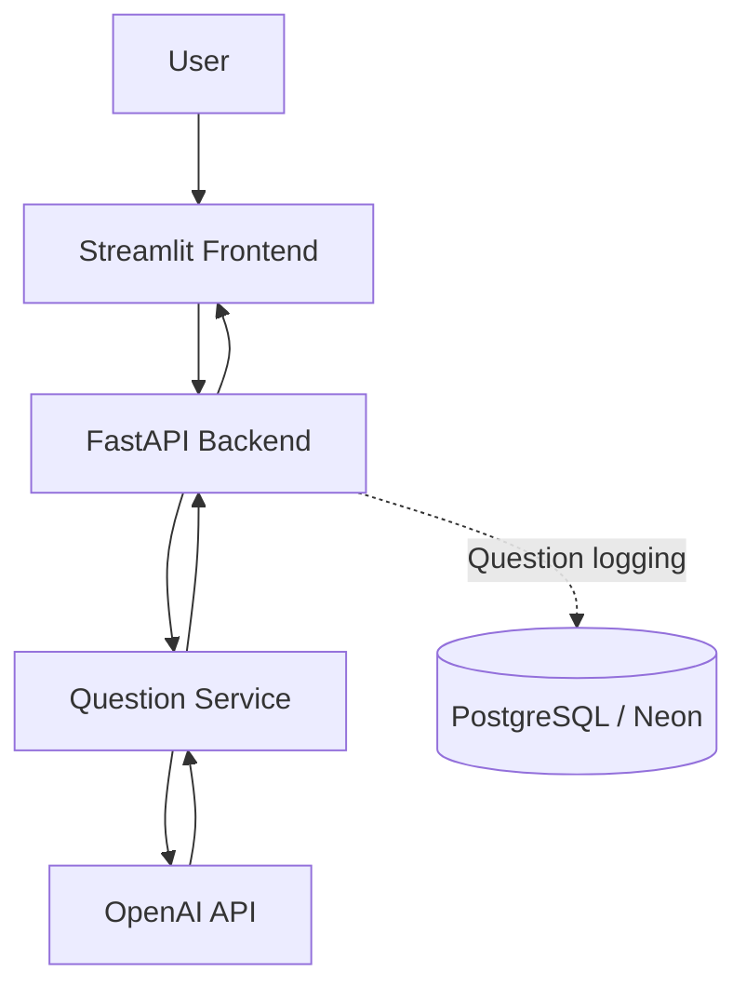

# DataDose — AI Data Science Interview Questions

**Your daily dose of Data Science.**

DataDose is an AI-powered interview practice application that generates data science and AI interview questions based on the selected difficulty level. It combines a Streamlit frontend, a FastAPI backend, and the OpenAI API to deliver questions through a simple web interface.

**Live application:** https://datadose.streamlit.app/  
**Backend API:** https://datadose-backend.onrender.com  
**API documentation:** https://datadose-backend.onrender.com/docs  
**GitHub repository:** https://github.com/sanjibanidash/daily-ai-question-app

---

## 1. Problem Statement

Preparing for data science interviews requires consistent practice across different difficulty levels. DataDose aims to make this practice accessible by generating interview questions on demand using a large language model.

The project also explores how an AI-powered application can be structured, tested, deployed, and connected to a relational database.

## 2. Features

- **Three difficulty levels:** Easy, Medium, and Hard.
- **AI-generated questions:** Generates a question on demand using the OpenAI API.
- **Simple interface:** Streamlit provides the user-facing application.
- **REST API:** FastAPI separates question-generation logic from the frontend.
- **PostgreSQL integration:** Database connectivity and question-logging functionality have been implemented; production persistence still requires final verification.
- **Cloud deployment:** The frontend and backend are hosted separately.

## 3. System Architecture

The application separates the user interface, API, business logic, and data storage responsibilities.



### Component responsibilities

| Component | Responsibility |
|---|---|
| Streamlit | Displays the interface and selected question difficulty |
| FastAPI | Exposes the question-generation endpoint |
| Question service | Builds the generation request and calls the OpenAI API |
| OpenAI API | Generates interview questions |
| PostgreSQL / Neon | Provides relational storage for generated-question records |
| GitHub | Source control and pull-request workflow |
| Render | Hosts the FastAPI backend |
| Streamlit Community Cloud | Hosts the frontend |

**Request flow:** The user selects a difficulty and requests a question. The frontend sends an HTTP request to FastAPI. The backend invokes the question service, receives the generated question, and returns a JSON response to the frontend.

Database logging is a separate persistence concern and must be verified independently of a successful API response.

## 4. Technology Stack

- **Language:** Python
- **Frontend:** Streamlit
- **Backend:** FastAPI, Uvicorn
- **AI integration:** OpenAI API
- **Database:** PostgreSQL, Neon
- **Database driver:** Psycopg
- **Configuration:** Environment variables and python-dotenv
- **Testing:** pytest
- **Version control:** Git and GitHub
- **Deployment:** Render and Streamlit Community Cloud

## 5. Repository Structure

The project separates frontend code from backend responsibilities.

```text
daily-ai-question-app/
├── backend/
│   ├── api/
│   │   └── routes.py
│   ├── config/
│   │   └── settings.py
│   ├── services/
│   │   └── question_service.py
│   ├── database.py
│   ├── main.py
│   ├── check_database_connection.py
│   ├── test_database.py
│   └── requirements.txt
├── frontend/
│   ├── app.py
│   └── requirements.txt
├── .env.example
├── .gitignore
└── README.md
```

The tree above describes the principal files implemented during development. Optional files and configuration may differ in the current repository.

## 6. API Documentation

### Health check

**Method:** `GET`

**URL:** `/`

The root endpoint provides a basic health response from the backend.

### Generate an interview question

**Method:** `POST`

**URL:** `/api/v1/question`

**Example request:**

```json
{
  "difficulty": "Easy",
  "topic": "SQL"
}
```

The topic is supported by the backend request model; the main V1 interface focuses on difficulty selection.

**Example response:**

```json
{
  "question": "Write a SQL query to calculate total revenue by product.",
  "difficulty": "Easy",
  "topic": "SQL"
}
```

The question text above is illustrative. Actual output is generated dynamically, so responses will vary.

### Test the API

Open the interactive Swagger documentation:

https://datadose-backend.onrender.com/docs

Select the question-generation endpoint, enter a request, and execute it to inspect the response and HTTP status code.

## 7. Local Setup

### Prerequisites

- Python 3.11 or another Python version supported by the project's dependencies
- Git
- An OpenAI API key
- PostgreSQL access if testing database functionality

### Clone the repository

```bash
git clone https://github.com/sanjibanidash/daily-ai-question-app.git
cd daily-ai-question-app
```

### Set up the backend

Create and activate a virtual environment:

```bash
python -m venv .venv
```

On Windows PowerShell:

```powershell
.\.venv\Scripts\Activate.ps1
```

Install backend dependencies:

```bash
pip install -r backend/requirements.txt
```

Configure the required environment variables using the names expected by the backend configuration. For local development, keep actual credentials in `.env`.

At minimum, configure the OpenAI API key and the model setting expected by `backend/config/settings.py`. Configure the database connection only when testing PostgreSQL functionality.

Start the backend from the repository root:

```bash
uvicorn backend.main:app --reload
```

The local API should be available at:

http://127.0.0.1:8000

Swagger documentation:

http://127.0.0.1:8000/docs

### Set up the frontend

Open a second terminal, activate the virtual environment, and install the frontend dependencies:

```bash
pip install -r frontend/requirements.txt
```

Configure `BACKEND_URL` to point to the running local backend:

```text
http://127.0.0.1:8000
```

Launch Streamlit:

```bash
streamlit run frontend/app.py
```

The terminal will display the local application URL.

> Run the frontend and backend in separate terminals during local development.

## 8. Environment Variables and Security

Credentials must never be committed to GitHub.

Depending on the component and its configuration, the application uses environment variables for:

| Variable | Purpose |
|---|---|
| `OPENAI_API_KEY` | Authenticates requests to OpenAI |
| `OPENAI_MODEL` | Selects the configured language model |
| `BACKEND_URL` | Configures the frontend's backend URL |
| `DATABASE_URL` | PostgreSQL connection URL, if used by the deployed backend |

Confirm the exact variable names in the current source code and deployment settings before configuring a new environment.

### Security practices

- Keep `.env` out of version control.
- Use `.env.example` with placeholder values only.
- Store production secrets in the hosting platform's environment settings.
- Never place the OpenAI API key in frontend code.
- Never commit database passwords or connection strings.
- Use encrypted database connections where supported.
- Avoid logging credentials or sensitive connection details.

## 9. Database Design

The generated-question logging implementation uses a PostgreSQL table named `generated_questions`.

The table includes:

| Column | Purpose |
|---|---|
| `id` | Record identifier |
| `question` | Generated question text |
| `difficulty` | Selected difficulty |
| `topic` | Question topic |
| `created_at` | Record creation timestamp |

A successful question-generation response does not, by itself, prove that the database insert succeeded.

**Known limitation:** Local database functionality has been tested, but production question logging has not yet been confirmed to persist every newly generated question. The deployed database integration should be considered incomplete until this is resolved.

## 10. Testing and Validation

The development workflow includes:

- Python compilation checks using `python -m compileall backend`
- Automated tests using `python -m pytest`
- Whitespace and patch validation using `git diff --check`
- Database connection checks
- API testing through Swagger
- Manual verification of generated-question records using SQL

A successful compilation confirms that Python files can be compiled; it does not prove that the entire application works correctly.

Likewise, a successful API response and a successful database insert are separate outcomes and should be tested independently.

## 11. Deployment

### Backend — Render

The FastAPI backend is deployed as a Render Web Service.

The service starts Uvicorn using the configured command:

```bash
uvicorn backend.main:app --host 0.0.0.0 --port $PORT
```

The service is connected to the GitHub repository and deploys from `main`.

Production configuration and secrets are managed through Render environment settings.

### Frontend — Streamlit Community Cloud

The Streamlit frontend is deployed separately.

The frontend must use the public HTTPS backend URL through its `BACKEND_URL` configuration. It must not use `localhost` or `127.0.0.1` when communicating with the deployed backend.

## 12. Version Control Workflow

The project uses Git and GitHub to track changes.

The development workflow includes:

1. Implement changes on a feature branch.
2. Run available tests and validation checks.
3. Commit changes with descriptive messages.
4. Push the branch to GitHub.
5. Open a pull request against `main`.
6. Review the changed files and merge the pull request.
7. Verify the deployment triggered from the updated `main` branch.

This workflow helps keep development changes traceable and reduces the risk of modifying the live application without verification.

## 13. Current Status and Limitations

### Working and verified

- The Streamlit frontend is deployed.
- The FastAPI backend is deployed.
- The question-generation endpoint returns successful responses.
- Difficulty-based AI question generation works.
- The Neon connection URL support has been added to the backend.
- Local database configuration tests have passed.

### Still requiring verification

- Production database logging must be confirmed by checking that new API requests create new database records.
- Database insert failures should be observable through appropriate error handling and logs.

The application should not be described as having fully verified production persistence until this final check passes.

## 14. Key Engineering Learnings

Building DataDose provided practical experience with:

- Separating frontend and backend responsibilities
- Designing and testing REST API contracts
- Integrating a language model through an API
- Managing secrets through environment configuration
- Connecting Python applications to PostgreSQL
- Debugging differences between local and cloud environments
- Using Git branches and pull requests
- Deploying and validating a cloud-hosted application
- Distinguishing successful API generation from successful database persistence

## 15. Future Improvements

Potential improvements include:

- Resolve and verify production database logging.
- Add integration tests for database writes.
- Improve error handling and operational logging.
- Add automated testing to the GitHub workflow.
- Improve observability for API latency and failures.
- Add user authentication and question history only if required by future product scope.

---

## Author

**Sanjibani Dash**

GitHub: https://github.com/sanjibanidash

DataDose was built as a learning project to understand the engineering lifecycle of an AI-powered application, from requirements and architecture to API integration, testing, version control, and cloud deployment.
